  

  

## 🎨 Обо мне

- 🎓 Студент **ИГУ · «Дизайн»**
- 🧊 **3+ года** в 3D-моделировании (Blender)
- 🎬 Motion, монтаж, звук — After Effects · Premiere Pro · Audition
- 🖌 Графика и UI — Figma · Photoshop · Illustrator
- 💻 Пишу на Python/JS, верстаю, разворачиваю через Cloudflare

## 🛠 Стек

<b>🎨 Дизайн & Видео</b>

 

<b>🧊 3D</b>

 

<b>💻 Код & Инфраструктура</b>

 

## 📊 GitHub Stats

  
  

## 📫 Связаться

  
  
  

<i>«Дизайн — это не то, как оно выглядит. Дизайн — это то, как оно работает.»</i>

